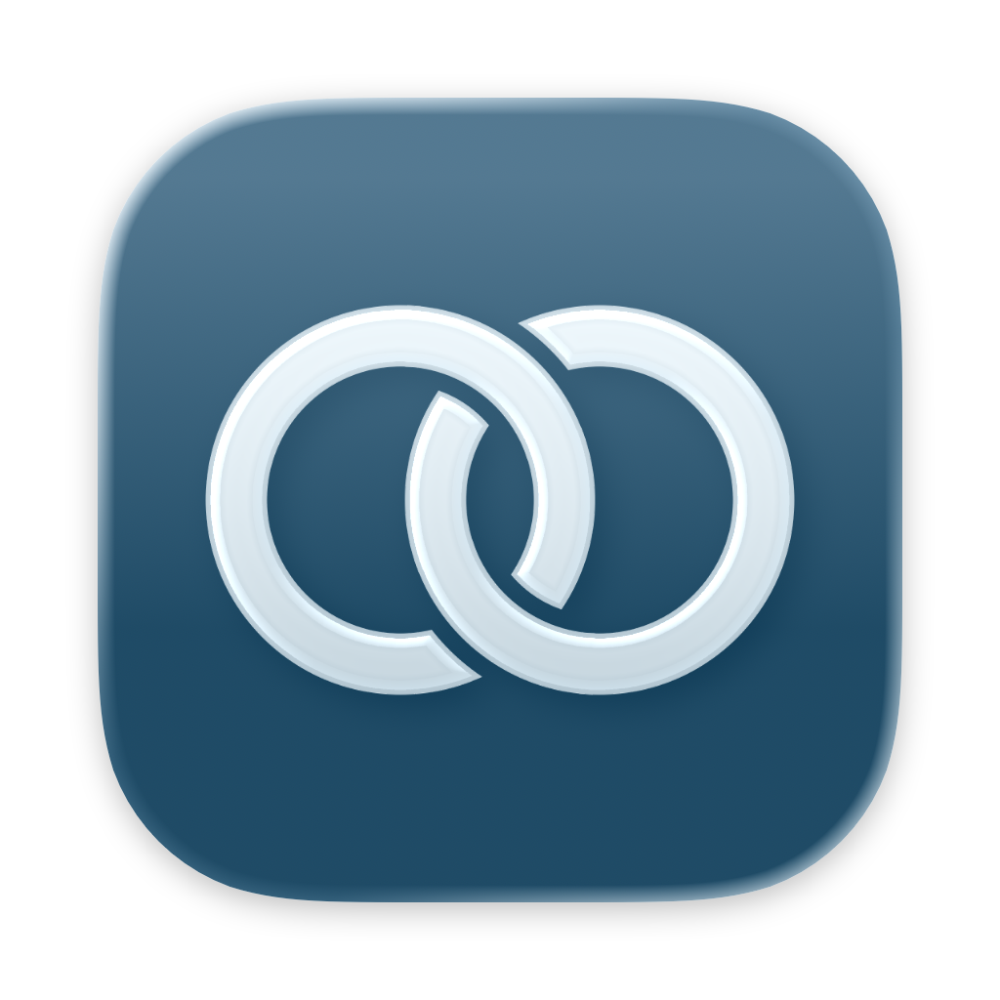
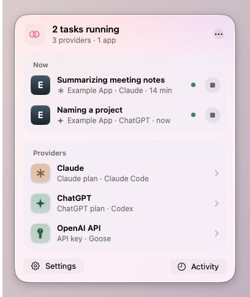
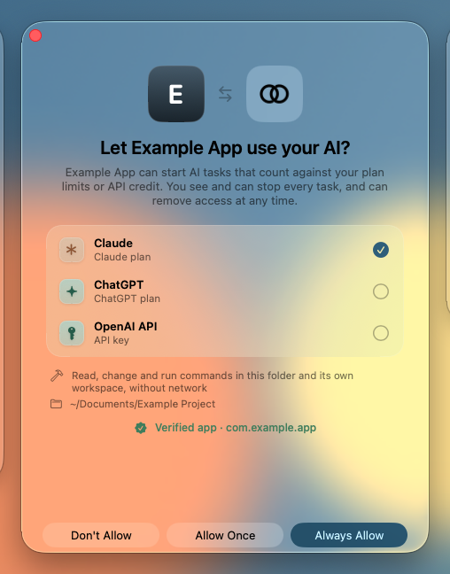

<p align="center">
  
</p>

<h1 align="center">Agneta</h1>

<p align="center"><strong>Give Mac apps an AI agent you control.</strong></p>

<p align="center">
  <a href="https://github.com/olofd/agneta/releases/latest"></a>
  <a href="https://github.com/olofd/agneta/actions/workflows/ci.yml"></a>
  <a href="docs/CONTAINMENT.md#supported-macos-versions"></a>
  <a href="https://github.com/olofd/homebrew-tap"></a>
  <a href="LICENSE"></a>
</p>

<p align="center">
  <a href="https://agneta.dahlbom.io">Website</a> ·
  <a href="https://github.com/olofd/agneta/releases/latest">Download</a> ·
  <a href="https://agneta.dahlbom.io/docs/">Documentation</a> ·
  <a href="CHANGELOG.md">Changelog</a>
</p>

Agneta is a free, open-source menu bar app that runs AI agents for your other Mac apps, with you in control. An app asks before it can use one, and you decide what it may reach. Every task runs in a sandbox on your Mac, shows in the menu bar, and stops with one click. The agents run on the AI account you connect once (a ChatGPT or Claude plan, or an API key), and no app ever sees your password or key.

**Building a Mac app?** Add agent features without building an agent. Agneta runs a proven one (Claude Code, Codex, Goose or OpenCode) with your app's own tools, handles sign-in, consent and sandboxing, and streams the work back over one local connection in the open [Agent Client Protocol](https://agentclientprotocol.com) (ACP). Your users' own AI accounts pay for it, so there's no backend to run and no AI bill. The [TypeScript](clients/typescript/README.md) and [Swift](clients/swift/README.md) clients do the talking for you; any language with a WebSocket works.

<!-- The demo video goes here, above the screenshots: 20 seconds of an app pairing, a task running in the panel, and
     Stop. Drag the .mp4 into this file in GitHub's web editor, which uploads it and puts its URL on a line of its own;
     GitHub shows that line as a player. On the website, put the same file at docs/images/demo.mp4 (site/README.md). -->

<p align="center">
  <picture>
    <source media="(prefers-color-scheme: dark)" srcset="docs/images/panel-dark.png">
    
  </picture>
  &nbsp;&nbsp;
  <picture>
    <source media="(prefers-color-scheme: dark)" srcset="docs/images/approval-dark.png">
    
  </picture>
</p>

**[Download Agneta](https://github.com/olofd/agneta/releases/latest)** for Apple silicon or Intel, or run `brew install olofd/tap/agneta`. It needs macOS 14 or later. More on [the website](https://agneta.dahlbom.io).

> **Status: early.** Agneta runs real tasks on real ChatGPT and Claude plans. Before you rely on it, know that:
> - the app protocol may still change before 1.0;
> - an engine can reach any HTTPS host, not only its provider's (a per-provider host allowlist isn't built yet);
> - apps that edit files and run commands get developer access unless you choose Contained: their commands reach the internet and read your home folder (credentials and Agneta's data excepted);
> - the tests, the sandbox acceptance test among them, pass on macOS 15 and 26, Apple silicon and Intel ([CI.md](docs/CI.md)), but the app has been used day to day only on an Intel Mac with macOS 26, and macOS 14 is untested.

## What it is

- **A local agent runtime that apps share.** An app sends a task: a workspace folder, its own tools (an MCP server), instructions and limits. Agneta runs an agent engine on it and streams back ACP updates, usage and a full trace.
- **One place for your providers.** It handles sign-in for ChatGPT and Claude plans through your own Codex's and Claude Code's logins, so Agneta never holds a plan's tokens. API keys stay in your Keychain. One provider can serve several apps, and every task shows which app it belongs to, which provider it runs on and what it costs.
- **A consent layer.** An app has to pair before it can do anything. You approve it in a window that shows whether its code signature checks out and what it will be able to do (its tools and folders), and you choose which of your providers (plans and API keys) it may use, once or always, and for an app that edits files and runs commands, Developer access or Contained. Engines are all allowed unless you narrow them (Engines… in that window, or Advanced in Settings → Apps); the app picks the engine for each task. In Settings → Apps you can also limit each app: what it may spend on your API keys a day, week or month, how many of its tasks run at once, and how many new ones it starts. You can see and stop every task, and remove an app's access at any time.
- **A sandbox.** Every engine runs under a macOS sandbox profile. When contained, it can read the task's workspace, the folders the policy names and what the engine itself needs, and nothing else in your home folder. The engine itself can reach any HTTPS host, which is how it reaches its provider. Shell commands, on every engine, go through Agneta and run under an even stricter profile, confined to the workspace with no network. Developer access, the default for an app that edits files and runs commands (you can choose Contained when you approve it, or later in Settings), gives a terminal's reach instead: the home folder apart from credentials and Agneta's data, the internet and your own toolchains. [docs/ARCHITECTURE.md](docs/ARCHITECTURE.md#sandbox-profiles) lists exactly what each part can reach.
- **Typed results.** An app can ask a task for a value that matches its own JSON Schema: an invoice read from a PDF, a form filled in from a conversation. The model submits it through a tool Agneta serves, Agneta checks every value it receives the same way on every engine (OpenCode also checks a call's shape itself first) and tells the model what to fix, and the app gets the value, or a plain reason why there is none.
- **A flight recorder.** Every task leaves a structured trace: prompts, tool calls, model calls, permission decisions and timing. You read it with the `agneta-diag` command-line tool or an optional local MCP server. Apps can read their own tasks' traces live.

## What it is not

- **Not a model proxy.** Agneta doesn't hand apps an OpenAI-compatible endpoint backed by your subscription. Apps get agent tasks, run under rules you can see, not raw model access.
- **Not a chat app.** There's no chat window. The apps you use are the interface.
- **Not a way around provider terms.** Agneta uses your own accounts and your own installed Claude Code and Codex. Whether a given use fits a provider's terms is between you and that provider. See [docs/TERMS.md](docs/TERMS.md).
- **Not a coding agent of its own.** It hosts proven open-source and vendor agents ([Goose](https://github.com/aaif-goose/goose), [OpenCode](https://github.com/anomalyco/opencode), Claude Code and Codex) behind one boundary.
- **Not a service.** Everything listens on loopback only and browsers are refused. Agneta has no servers of its own and sends no telemetry (release builds check GitHub for updates, once you allow it); engines talk to their AI provider, with their own analytics and update checks turned off where they allow it.

## What it's for

**Apps that want an agent but not a backend.** A music tool that lets an agent tune a model against its own renders, a notes app that summarizes and files, a research tool that reads a folder of papers. The app keeps its own tools and data and exposes them as an MCP server on loopback. Agneta runs the agent loop with those tools, on the user's account, inside a policy the app declares and the user can see.

**People who already pay for an AI plan.** You can use that plan in the apps you choose, see what each one does with it, and stop it.

## How it works

```
 Your app ──ACP over ws://127.0.0.1──▶ Agneta ──ACP over stdio──▶ Agent engine (sandboxed)
    ▲                                    │                          │
    └──── MCP over loopback (your tools) ◀──────────────────────────┘
                                         │
                       accounts · consent · policy · limits · traces
```

1. **Pair once.** The app connects and calls `agneta/pair` with the scope it needs (tools and folders, and optionally providers, engines and sandbox mode). Agneta identifies the process by its code signature; the user sees the scope, ticks the providers it may use, chooses Developer access or Contained, and allows it once or always. The app keeps a token in its Keychain, and `agneta/access` tells it which providers and engines it may use.
2. **Start a session.** It calls `session/new` with a provider and, if it wants, an engine, a workspace, the app's MCP server and a policy, for example `{"tools": "workspace", "sandbox": "contained", "network": "none", "limits": {"maxTurns": 200}}`. Agneta refuses any policy it can't enforce rather than quietly weakening it.
3. **Prompt.** Agneta queues the turn within the account's limits and the ones you set for the app and starts or reuses an engine under the right sandbox profile. It streams the engine's ACP updates back, answers permission requests from the policy (or asks the app), and returns usage with the result.
4. **Watch and stop.** The task appears in the menu bar panel, its trace is written as it runs, and the user can stop it at any time.

Plain ACP works unchanged. Agneta's own extensions (`agneta/policy`, `agneta/usage`, `agneta/steer`, `agneta/fork`, `agneta/trace` and others) are listed in `initialize`, and an app that ignores them still works.

### Providers and engines

| Provider | Engines | Sign-in |
| --- | --- | --- |
| ChatGPT plan | Codex | Your installed Codex's own login, kept per account |
| Claude plan | Claude Code, Goose | Your installed Claude Code's own login, kept per account; both engines run that Claude Code |
| OpenAI API key | Goose, OpenCode, Codex | Key in the Keychain |
| Anthropic API key | Goose, OpenCode, Claude Code | Key in the Keychain |

**Without Claude Code or Codex,** Agneta still works with an OpenAI or Anthropic API key, on Goose (bundled) or OpenCode (downloaded when first needed). A Claude plan needs Claude Code (the Claude desktop app includes it), and a ChatGPT plan needs Codex 0.166 or later.

Goose comes bundled; OpenCode, which would be over half of Agneta's size, is downloaded the first time it's needed. Both are pinned by version and SHA-256. Claude Code and Codex are your own installs: Agneta finds them, including the copy inside the Claude desktop app, and never redistributes them. Engines differ in what they can do (steering, forking, cost reporting), and Agneta exposes each one's extras instead of hiding them behind a common subset. See [docs/ENGINES.md](docs/ENGINES.md).

## Install

Download the DMG for your Mac (Apple silicon or Intel) from the [latest release](https://github.com/olofd/agneta/releases/latest), open it and drag Agneta to Applications. Or, with [Homebrew](https://brew.sh):

```bash
brew install olofd/tap/agneta
```

Releases are signed with a Developer ID and notarized by Apple, and need macOS 14 or later. Agneta asks before it first checks for updates; after that it keeps itself current, installing an update only when no task is running.

- The connected-rings symbol appears in the menu bar. Connect a provider from its panel.
- To see the app side, choose **Run a Test Task** from the panel's ⋯ menu. A small sandboxed test app asks for access; once you allow it, it runs one short task and shows the reply.
- Apps connect at `ws://127.0.0.1:47321/acp`. Agneta keeps its data in `~/Library/Application Support/com.objectivecoder.agneta/`.

## Build and run

You need **Xcode 26 or later** (Swift 6.2 and the macOS 26 SDK, which the app's glass look is built with), and network access to GitHub, nodejs.org and registry.npmjs.org for the engines (about 170 MB to download the first time, about 400 MB unpacked). The app runs on macOS 14 or later; the glass look needs macOS 26.

```bash
git clone https://github.com/olofd/agneta.git && cd agneta
scripts/dev/build-app              # fetches the pinned engines, builds and signs ad hoc
open "build/Agneta Dev.app"
```

- As with a release, the connected-rings symbol appears in the menu bar, and **Run a Test Task** in the panel's ⋯ menu shows the app side.
- Development builds listen on `ws://127.0.0.1:47331/acp` and keep their data in `~/Library/Application Support/com.objectivecoder.agneta.dev/`. They run side by side with a release: their own port, data, Keychain items, logs and `agneta-dev://` URL, and a small hammer on the app icon and the menu bar mark tells them apart. The bundle identifiers (`com.objectivecoder.agneta`, and `.dev` for development builds) use the author's developer name. They also name Agneta's data folder, Keychain items and logs, so they stay the same from release to release.
- For a throwaway instance, `AGNETA_HOME=<folder> AGNETA_PORT=<port> "build/Agneta Dev.app/Contents/MacOS/Agneta"` keeps its data, Keychain items and Reset inside that folder. Give each instance its own port (diagnostics listen two above it); one without `AGNETA_PORT`, or on your own Agneta's ports, doesn't listen and says why.

Tests:

```bash
scripts/fetch-engines --engine all  # the pinned Goose and OpenCode the integration tests run
swift build && swift test           # unit, contract and integration tests, with fake models and the real engines
AGNETA_REAL_PROBE=1 AGNETA_REAL_PROBE_HOME=<folder> swift test --filter realProbe   # optional: a real round on your own accounts
```

The integration tests run the real engines against a fake model and tool server (`AgnetaFakes`, served from the test process; Project Chat's smoke test runs them with `agneta-fakes`). Without the engines, those suites are skipped and say why. The round scripts in `scripts/dev` use `python3` (standard library only, as Xcode's command line tools provide).

**The website,** [agneta.dahlbom.io](https://agneta.dahlbom.io), is built from this repository's documents by `site/build.py` and published by GitHub Pages ([site/README.md](site/README.md)). To build it and look at it locally:

```bash
python3 site/build.py && python3 -m http.server 8642 --bind 127.0.0.1 --directory site/_build
```

## For app developers

**Building a native Mac app?** Use the [Swift client](clients/swift/README.md), available as the `AgnetaClient` Swift package product: async turns and streaming, Keychain pairing tokens, policies, tools and typed structured results.

**Try the [Project Chat example](examples/project-chat/README.md).** This small Electron app, built on [`@agneta-ai/client`](clients/typescript/README.md) like Replica Bench, pairs with Agneta, keeps its access and reconnects by itself, helps the user get Agneta when it isn't installed and open it when it isn't running, lets you choose Agneta or Agneta Dev, lets you pick the provider, engine, model and effort, streams a conversation, and lets the agent propose a note for you to review. **[Replica Bench](examples/replica-bench/README.md)** shows the sandbox modes: it runs a demanding workload on every engine in both modes, and shows what each task got and how a refusal looks.

Your app is an ACP **client** and Agneta is the ACP **agent**. If your app already speaks ACP, most of what follows is familiar. What Agneta adds is how you reach it, how the user lets your app in, and the rules a task runs under.

| | Plain ACP | With Agneta |
| --- | --- | --- |
| Transport | Usually stdio to an agent process the client starts | A WebSocket on loopback (`ws://127.0.0.1:47321/acp`, or 47331 for development builds), one JSON-RPC 2.0 message per text frame. Agneta is already running; your app never starts an agent |
| Who may connect | Whoever starts the process | Apps the user approved. Pairing gives your app a token, sent in `initialize` |
| Which provider, engine and model | The agent's own configuration | The providers and engines the user allowed your app, picked per session (`agneta/access` lists them); model and effort through the engine's own config options |
| What the agent may touch | Whatever the agent process can reach | A policy you send with each session (tools, folders, sandbox mode, network, approval, limits), within the mode the user chose for your app, enforced by sandboxes, or refused |
| Typed results | Nothing standard | A value checked against your JSON Schema, on every engine ([Typed results](#typed-results)) |
| Afterwards | Nothing standard | Usage in every prompt result, and the task's full trace, live or later |

**In TypeScript or JavaScript (Node 22+ or Electron's main process), use [`@agneta-ai/client`](clients/typescript/README.md),** the official client. It does everything below for you, typed, and keeps a raw layer for anything else:

```js
import { AgnetaClient } from '@agneta-ai/client';

const client = new AgnetaClient({ name: 'Example App', tokens });   // tokens: where Always Allow's token is kept
await client.connect();                                             // pairs the first time, then reuses the token
const session = await client.newSession({ policy: { tools: 'app-only', approval: 'never-ask' } });
for await (const text of session.prompt('Sort these notes by topic.').textStream()) process.stdout.write(text);
```

Otherwise no SDK is needed. Any WebSocket and JSON-RPC 2.0 code will do, including in a sandboxed Mac App Store app. That needs `com.apple.security.network.client` to connect, plus `com.apple.security.network.server` if the app serves its own MCP tools; its folders come from the user (an open panel or a security-scoped bookmark), since Agneta keeps app containers out of reach ([details](docs/APP_PROTOCOL.md#connecting)). To see the whole exchange in Swift, read [`Sources/agneta-testclient/main.swift`](Sources/agneta-testclient/main.swift), the maintainers' test client: it pairs, opens a session with a policy and an MCP server, prompts and prints the stream in about 220 lines. It's a demonstration, not a client library: a real app keeps its token in the Keychain and reconnects with it, as Project Chat does.

### The conversation, step by step

`@agneta-ai/client` does each step below for you. They're here for apps in other languages, and to show what goes over the wire.

**1. Connect.** Open `ws://127.0.0.1:47321/acp`, the port of releases; development builds listen on 47331. If the connection is refused, Agneta isn't running, and may not be installed: ask LaunchServices which app opens `agneta://open`. If none does, offer to get it (the install page, `https://agneta.dahlbom.io/get/`, or Homebrew) and wait until it's installed; if it's installed, ask the user whether to open it, and on a yes open `agneta://open` (`agneta-dev://open` for development builds), wait for the port and connect. Never open it without asking. [Getting Agneta](docs/APP_PROTOCOL.md#getting-agneta) has the whole recipe, with the Swift calls. Before pairing you may call `agneta/catalog` (what Agneta offers: each kind of provider, whether one is connected, the engines; never the user's accounts) and `agneta/setup` (Agneta's window for connecting a provider). See [Before pairing](docs/APP_PROTOCOL.md#before-pairing-what-agneta-offers).

**2. Pair, once.** Ask to be let in, and show the user that you're waiting:

```json
→ {"jsonrpc": "2.0", "id": 1, "method": "agneta/pair",
   "params": {"name": "Example App", "scope": {"tools": "workspace", "folders": ["/Users/me/Documents/Example Project"]}}}
← {"jsonrpc": "2.0", "id": 1, "result": {"token": "…", "remembered": true, "access": {…}, "unmet": []}}
```

The `scope` says what your app will need: the most built-in tools, and the user's folders its sessions will work in. It can also name the provider kinds, engines and sandbox mode you want (`"providers": ["claude"]`, `"engines": ["claude-code"]`, `"sandbox": "contained"`), which narrow the approval window to them ([details](docs/APP_PROTOCOL.md#pairing-once-per-app)). Without a scope, your app gets its own tools only, in a workspace Agneta makes for it (`workspace`). Agneta opens its approval window, which shows the scope; the user ticks the providers your app may use (engines are all allowed unless they narrow them under Engines…), chooses Developer access or Contained for an app with `workspace` tools, and chooses Allow Once or Always Allow. `unmet` lists what of your ask wasn't given, and why. Every later session must fit the grant. If your app is signed with a Developer ID or App Store certificate, Agneta checks the signature and shows the app as verified. If it isn't (ad hoc or development builds), Agneta first sends you `agneta/pairingCode {"code": "123456"}`. Show that code; the user allows your app only if it matches the one in Agneta's window. When `remembered` is true (Always Allow), store the token in your Keychain and connect with it next time, without pairing; Allow Once ends with the connection. Pairing again with Always Allow replaces your app's access rather than adding to it; an unverified app starts afresh, with a new workspace. A refusal comes back as error `-32002`.

**3. Initialize, on every connection.**

```json
→ {"jsonrpc": "2.0", "id": 2, "method": "initialize",
   "params": {"protocolVersion": 1, "clientCapabilities": {}, "_meta": {"agneta": {"token": "…"}}}}
← {"jsonrpc": "2.0", "id": 2, "result": {"protocolVersion": 1, "agentCapabilities": {…},
   "_meta": {"agneta": {"extensions": ["agneta/policy", "agneta/access", "agneta/usage", …],
                        "access": {"providers": [{"id": "acct-1", "label": "Claude", "kind": "claude", "paused": false,
                                                  "engines": ["claude-code", "goose"], "defaultEngine": "claude-code"}],
                                   "engines": [{"id": "claude-code", "name": "Claude Code", "state": "ready", "capabilities": {…}}, …],
                                   "allowedEngines": "all", "scope": {…}, "workspace": "…"}}}}}
```

`access` is what your app may use: each provider with the engines its tasks there may run on (default first), and each engine's state on this Mac (`ready`, `downloading`, `downloadable`, `failed` or `unavailable`, with why). `agneta/access` returns it again at any time, and `agneta/accessChanged` arrives when it changes. Error `-32001` with `needsPairing` means the user removed your app, or the token is unknown: forget the token, and pair again when the user asks to connect.

**4. Start a session** in a workspace folder, with your own tools and a policy:

```json
→ {"jsonrpc": "2.0", "id": 3, "method": "session/new", "params": {
     "cwd": "/Users/me/Documents/Example Project",
     "mcpServers": [{"type": "http", "name": "app", "url": "http://127.0.0.1:52011/mcp",
                     "headers": [{"name": "Authorization", "value": "Bearer <per-session secret>"}]}],
     "_meta": {
       "agneta": {"account": "acct-1", "engine": "claude-code"},
       "agneta/policy": {"tools": "workspace", "sandbox": "contained", "network": "none", "approval": "never-ask",
                           "limits": {"maxTurns": 100, "maxSeconds": 900}},
       "agneta/task": {"title": "Tidying the project notes"},
       "agneta/instructions": {"text": "You are Example App's assistant."},
       "agneta/trace": {"live": true}}}}
← {"jsonrpc": "2.0", "id": 3, "result": {"sessionId": "s_…", "configOptions": […],
   "_meta": {"agneta": {"account": "acct-1", "sandbox": "contained",
                        "capabilities": {"engine": "claude-code", "steer": true, "fork": false, …}}}}}
```

- **Your tools** are an MCP server (Streamable HTTP) that your app runs on loopback, with a fresh bearer per session. Agneta accepts only loopback HTTP servers and masks the bearer in traces. A session with its own engine may reach exactly those ports; app-only sessions on Goose share one engine per account, and OpenCode runs a private server, so those may reach any loopback port. Your tools run in your app, with your app's permissions, not inside Agneta's sandbox.
- **`tools`** is `app-only` (only your MCP tools), `read` (plus reading files) or `workspace` (plus editing and a shell; confined to `cwd` when contained).
- **`sandbox`** is `contained` or `developer`, at most what the user chose for your app. Without it, a `workspace` session gets the grant's mode, and developer access is the default: commands reach the internet and read the home folder, as in a terminal, and `network` doesn't apply. Ask for `contained` unless you need that ([Sandbox](docs/APP_PROTOCOL.md#sandbox)). The result's `sandbox` says what the task got.
- **A policy Agneta can't enforce is refused** with `-32602` and `data.agneta.unenforceable` naming the field. Examples: an unknown field, a folder containing the home folder, a `sandbox` above what the user allowed, or a cost limit on an engine that can't report cost while a turn runs.
- **`engine`** is optional: without it, the provider's `defaultEngine`. One that's still downloading answers `-32015` with its progress; try again shortly.
- **`configOptions`** are the engine's own settings. Find the model and reasoning effort by their ACP categories, `model` and `thought_level` (each engine names them differently), and change them with `session/set_config_option`.
- **`capabilities`** tells you what this session's engine can do. Offer steering, forking or cost limits only where it says so.

**5. Prompt, and stream.**

```json
→ {"jsonrpc": "2.0", "id": 4, "method": "session/prompt",
   "params": {"sessionId": "s_…", "prompt": [{"type": "text", "text": "Sort these notes by topic."}]}}
← {"jsonrpc": "2.0", "method": "session/update", "params": {"sessionId": "s_…", "update": {"sessionUpdate": "agent_message_chunk", …}}}
← {"jsonrpc": "2.0", "method": "session/update", "params": {"sessionId": "s_…", "update": {"sessionUpdate": "tool_call", …}}}
   …
← {"jsonrpc": "2.0", "id": 4, "result": {"stopReason": "end_turn",
   "_meta": {"agneta/usage": {"modelCalls": 3, "inputTokens": 5120, "outputTokens": 410, "cost": null,
                                "costKind": "plan-equivalent", "billing": "subscription", "ms": 8210.4}}}}
```

The engine's standard ACP `session/update` notifications arrive unchanged, under your session id. With `"approval": "ask-app"`, tool permission requests come to you as standard `session/request_permission` requests. Answer them, and Agneta records your decision in the trace.

**6. While it runs and after.**

| You want to | Send |
| --- | --- |
| Add input to the running turn | `agneta/steer {"sessionId", "prompt"}` |
| Stop the turn | `session/cancel` (a notification) |
| Change model or effort between turns | `session/set_config_option {"sessionId", "configId", "value"}` |
| Change the instructions between turns | `agneta/instructions/set` |
| Reopen a task after a restart | `session/load` (pass your MCP servers again: bearers are per session) |
| Ask about a finished task without changing it | `agneta/fork` |
| Read the task's trace from any point | `agneta/trace/read {"sessionId", "after"}` |
| End it | `session/close` |

### Typed results

When your app needs data rather than prose, declare a JSON Schema when the session opens. The model submits the value through a tool Agneta serves; Agneta checks every call that reaches it against the schema (a documented subset of JSON Schema 2020-12, the same on every engine; OpenCode refuses a call that doesn't fit before it reaches Agneta) and tells the model what to fix, so it can correct itself within the turn.

```text
→ {"jsonrpc": "2.0", "id": 3, "method": "session/new",
   "params": {"cwd": "…", "mcpServers": [], "_meta": {
     "agneta/policy": {"tools": "app-only", "approval": "never-ask"},
     "agneta/result": {"schema": {"type": "object",
       "properties": {"number": {"type": "string"}, "total": {"type": "number"}},
       "required": ["number", "total"], "additionalProperties": false}}}}}
→ {"jsonrpc": "2.0", "id": 4, "method": "session/prompt",
   "params": {"sessionId": "s_…", "prompt": [{"type": "text", "text": "Read this invoice: …"}]}}
← {"jsonrpc": "2.0", "id": 4, "result": {"stopReason": "end_turn", "_meta": {
     "agneta/result": {"status": "valid", "name": "result", "mechanism": "tool", "attempts": 1,
                       "value": {"number": "A-1042", "total": 129.5}},
     "agneta/usage": {…}}}}
```

- **`status`** is `valid` with the value, `invalid` with the last refused value and its `issues`, or `missing` with a `reason` (`stopped`, `refused`, `truncated`, `not-submitted`). A missing or invalid result is still a successful reply.
- **Several schemas:** declare `{"schemas": {"invoice": {…}, "contact": {…}}, "every": "invoice"}` and ask per prompt with `_meta["agneta/result"]: {"name": "contact"}`, or `false` for a turn without one.
- **Valid isn't true.** A valid value has the right shape; whether it's right about the source is the model's work. Treat it as untrusted input.
- In TypeScript, `client.ask(prompt, { schema })` does all of it in one call and types the value from the schema ([the client](clients/typescript/README.md#structured-results)). Every field, limit and engine difference: [Structured results](docs/APP_PROTOCOL.md#structured-results).

### Messages your app should handle

| From Agneta | Meaning, and what to show |
| --- | --- |
| `agneta/catalogChanged {"catalog"}` | Before pairing: a provider was connected or removed, or an engine changed |
| `agneta/accessChanged {"access"}` | What your app may use changed: providers or engines added, removed, paused, downloading or ready, or its sandbox mode. Update your pickers |
| `agneta/queued {"sessionId", "position", "waitingFor"}` | The provider is busy, or (`waitingFor: "app"`) your app is at the user's limit of tasks at once; the turn waits its place and runs later |
| `agneta/sessionStopped {"stoppedBy": "user"}` | The user pressed Stop in Agneta. Show it as stopped, not as an error |
| `agneta/sessionStopped {"stoppedBy": "engine"}` | The engine ended on its own; resume the task with `session/load` |
| `agneta/sessionStopped {"stoppedBy": "limit"}` | A limit ended the session (the policy's, or the spending limit the user set for your app, named in `limit`); load it again to go on, on an engine that limit can count |
| `agneta/sessionStopped {"stoppedBy": "reach"}` | A contained session's socket or port is no longer served by your app (named in `reason`), so Agneta stopped it before its next command; serve it again and load the session |
| `agneta/rateLimited {"account", "resetsAt"}` | The provider's limit stopped the turn. Retry after `resetsAt`, or use another provider |
| Error with `data.agneta.needsSignIn` | The provider must sign in again; ask the user to open Agneta |
| `-32011` | A turn is already running in this session: steer it, or wait |
| `-32012` | Too many turns are waiting; try again shortly |
| `-32013` | The user paused this provider |
| `-32014` | This engine can't do that; check `capabilities` |
| `-32015` | The engine is still downloading (`data.agneta.engineDownloading`, with progress); try again shortly |
| `-32016` | The limit the user set for your app in Agneta is reached (`data.agneta.appLimit`, with when it resets); show it as their choice |

The full reference, with every field, limit and error, is **[docs/APP_PROTOCOL.md](docs/APP_PROTOCOL.md)**. Every step there is exercised by `Tests/AgnetaKitTests/AppScenarioTests.swift` against a real engine.

## Diagnostics

An app that hands its agent work to Agneta should see at least as much as it would by running the agent itself. So Agneta writes **one trace per task**, from the first message to the last, and lets three kinds of reader at it:

| Reader | How | Sees |
| --- | --- | --- |
| The app that ran the task | `agneta/trace` over its ACP connection: live notifications, or `agneta/trace/read` pages afterwards | Its own tasks only |
| An agent or a developer debugging a run | The diagnostics MCP server, once the user turns it on | Every task |
| People and scripts | `agneta-diag` on the command line, or the JSON Lines files | Every task |

**What a trace holds.** Each trace is a JSON Lines file, `Traces/<task>.jsonl` in Agneta's Application Support folder, readable by your user only. It records:
- the task's metadata (app, account, engine and version, policy);
- every prompt;
- every tool call, with its full input, result, status and exact timing;
- every model call, with its model, tokens, cache use and cost, read from the engine's own records;
- every turn's summary;
- every permission decision and who made it;
- shell commands with their exit codes;
- engine starts, stops and errors;
- optionally, the raw ACP frames of both connections.

Records are numbered without gaps and carry wall-clock and monotonic times. API keys, tokens, bearers and JWTs are masked before anything is written.

**The diagnostics MCP server** lets an agent such as Claude Code answer questions like "which tool calls failed in turn 12?" without parsing megabytes of JSON. It's off until you turn on **Allow diagnostic tools** in Settings → Advanced, which creates a token and can copy the command to add it:

```bash
claude mcp add --transport http agneta-diagnostics http://127.0.0.1:47323/mcp \
  --header "Authorization: Bearer <token>"
```

It has these tools:
- `list_tasks` and `task_summary`;
- `tool_calls`, which can be filtered to errors, one tool or one turn;
- `model_calls`;
- `read_trace` and `tail`;
- `engine_log` and `agneta_log`.

It listens on loopback only, two ports above the apps' port (47323 for releases, 47333 for development builds), and refuses browsers.

**`agneta-diag`** is bundled in the app: `/Applications/Agneta.app/Contents/MacOS/agneta-diag` for a release, or `"build/Agneta Dev.app/Contents/MacOS/agneta-diag"` when you built it from source. Or run `swift run agneta-diag` in the repository.

```bash
agneta-diag tasks                                         # recent tasks, newest first
agneta-diag summary <task>                                # turns, tools by time with failures and p95, tokens, cost, decisions
agneta-diag show <task> --types tool-call,tool-result     # selected records, readable or --json
agneta-diag tail -f <task>                                # follow a running task
agneta-diag export <task> --out trace.jsonl --redact-content   # for a bug report: content, names and paths removed
agneta-diag log --errors                                  # Agneta's own log
```

A task can be named by any unique prefix of its id. The same summary and timeline are in Settings → Activity → Details.

**Agneta's own log** is `~/Library/Logs/Agneta/agneta.jsonl`. It holds what Agneta itself did (starts, pairing, tasks, limits, sign-in), with ids, counts and timing only, never prompts, tool content or keys.

**Retention.** Traces live as long as task history: 30 days by default, or a week, 90 days or none, set in Settings → Privacy. Clear History and Reset delete them.

The trace format and every record type are in **[docs/DIAGNOSTICS.md](docs/DIAGNOSTICS.md)**.

## Documentation

The documents below are also on [agneta.dahlbom.io/docs](https://agneta.dahlbom.io/docs/), rendered from this repository.

| Document | For |
| --- | --- |
| [docs/APP_PROTOCOL.md](docs/APP_PROTOCOL.md) | The protocol in full, for integrating an app: connecting and pairing, sessions and their policy, the sandbox modes, model choice, turns, permissions, the trace, and every error |
| [clients/swift/README.md](clients/swift/README.md) | `AgnetaClient`, the official Swift client: async turns, Keychain pairing, policies, tools, traces and typed results |
| [clients/typescript/README.md](clients/typescript/README.md) | `@agneta-ai/client`, the official TypeScript client: a quick start, and every class, option, event and error |
| [docs/ARCHITECTURE.md](docs/ARCHITECTURE.md) | How Agneta is built, and its security model |
| [docs/ENGINES.md](docs/ENGINES.md) | Goose, OpenCode, Claude Code and Codex behind the engine boundary |
| [docs/DIAGNOSTICS.md](docs/DIAGNOSTICS.md) | Traces, `agneta-diag` and the diagnostics MCP server |
| [docs/PRIVACY.md](docs/PRIVACY.md) | What leaves your Mac, what stays and for how long, what each action removes, and the threat model |
| [docs/CONTAINMENT.md](docs/CONTAINMENT.md) | How engines are confined, how that's checked on each macOS, and the plan if `sandbox-exec` goes |
| [docs/CI.md](docs/CI.md) and [docs/RELEASING.md](docs/RELEASING.md) | What CI checks; how a release is built, signed, smoke-tested, and what it weighs |
| [CHANGELOG.md](CHANGELOG.md) | What changed in each release |
| [docs/TERMS.md](docs/TERMS.md) | Accounts, provider terms and trademarks |
| [THIRD_PARTY.md](THIRD_PARTY.md) | Bundled and downloaded components and their licences |

## Contributing and security

Contributions are welcome. See [CONTRIBUTING.md](CONTRIBUTING.md). Agneta handles credentials and runs code on people's Macs, so report vulnerabilities privately as described in [SECURITY.md](SECURITY.md), not in public issues.

## Licence

Apache License 2.0. See [LICENSE](LICENSE) and [NOTICE](NOTICE). Bundled and downloaded components keep their own licences ([THIRD_PARTY.md](THIRD_PARTY.md)).

Agneta is an independent project. It isn't affiliated with or endorsed by OpenAI, Anthropic, the Agent Client Protocol maintainers, or the Goose or OpenCode projects. Product names and logos belong to their owners.
