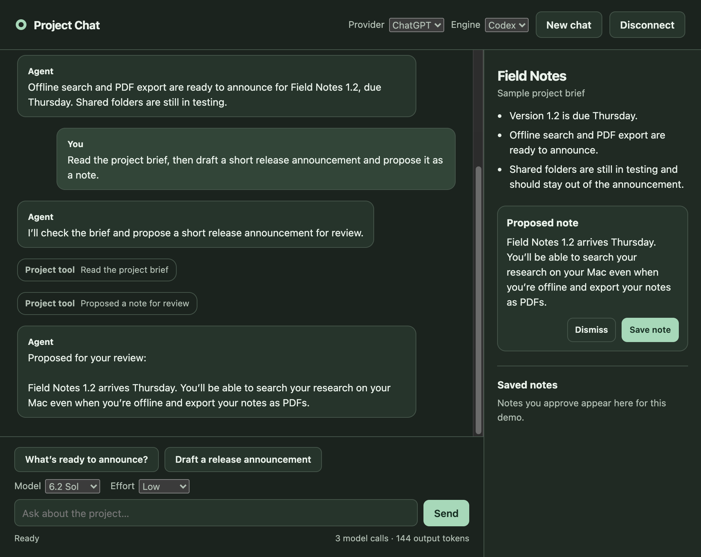

# Project Chat

Project Chat is a small Electron app that runs an agent through Agneta. The agent can read the fictional Field Notes project brief and propose a release note. The proposal appears in Project Chat for a person to save or dismiss.



## Run it

Open a recent [Agneta build](../../README.md#build-and-run). For the tested setup, connect a provider (a plan or an API key) in Agneta. Project Chat offers the engines that provider can run on and picks its default; any of them works. See [which engines work with each provider](../../README.md#providers-and-engines). From the repository root, run the example with Node.js 24 or newer.

```sh
cd examples/project-chat
npm ci
npm start
```

To open it from Finder or the Dock like any app, run `npm run bundle` once and open `build/Project Chat.app` (keep that in the Dock, not the Electron icon `npm start` shows, which opens bare Electron once Project Chat has quit). Closing its window leaves it running; its Dock icon opens it again.

Project Chat opens its session as soon as it's connected, so the **Model** and **Effort** pickers show the engine's own choices before the first message (found by their ACP categories, `model` and `thought_level`; each shown only where there's a choice). Changing either applies between turns and carries over to the next chat.

When Agneta isn't running, Project Chat asks whether to open it (**Open Agneta Dev**), opens it through `agneta-dev://open` (`agneta://open` for a release), waits for it, and connects. It never opens Agneta without asking.

Project Chat connects to dev builds on port `47331`. For a release build, use `AGNETA_PORT=47321 npm start` (or `AGNETA_PORT=47321 npm run bundle`, which the bundle keeps). For an [isolated dev instance](../../README.md#build-and-run), use the port you gave Agneta, for example `AGNETA_PORT=47341 npm start`.

### Try the workflow

1. Click **Connect to Agneta**. Compare the pairing codes if they appear, tick a provider in Agneta, and choose **Always Allow** (it reconnects by itself next time) or **Allow Once**. Project Chat requests app-only tools and no folders. Pairing itself makes no model calls.
2. Click **What’s ready to announce?**, then **Send**. A **Read the project brief** tool event should appear. The reply should mention offline search and PDF export, with shared folders still in testing.
3. Click **Draft a release announcement**, then **Send**. Check the **Proposed note** in the sidebar and choose **Save note** or **Dismiss**. The tool can stage text, and only the app’s **Save note** action puts it in **Saved notes**.
4. Open Agneta’s menu and find **Field Notes · Project Chat**. Use **Stop** in Project Chat to cancel a turn, or **Stop** in Agneta to end the session. **New chat** closes the session and clears the transcript and any unreviewed proposal. Saved demo notes stay in the app until it quits.

The model chooses if and when to call a tool. If you get a draft in the conversation only, ask the agent to use `propose_note`. Sending a message can use plan allowance or API credit. The provider receives the prompt and tool results. Project Chat keeps the conversation and notes in memory. Agneta keeps task traces according to [its privacy and retention settings](../../docs/PRIVACY.md). A trace can include a proposal even when you dismiss it.

## Follow the integration

```text
Renderer ── fixed IPC actions ──► Electron main ── ACP WebSocket ──► Agneta ──► engine
                                        ▲                                        │
                                        └───── MCP over loopback with bearer ────┘
```

1. [**Pair, or connect with a kept token**](chat.mjs). With a token kept from an earlier **Always Allow**, Electron main passes it to `initialize` and connects without asking; at launch it does this by itself. Otherwise it sends `agneta/pair` with an app-only scope, keeps the token when the answer says `remembered` ([in the Keychain](main.mjs), through Electron's `safeStorage`), and initializes with it. When Agneta no longer accepts the token (access removed in Settings → Apps), it forgets it and says so; **Connect** then asks again. It reads what it may use and its workspace from Agneta's access report. The token never leaves the main process.
2. [**Register app tools**](project-tools.mjs). On the first message, the app starts a stateless MCP server bound to `127.0.0.1` on an OS-assigned port. It registers that endpoint and a fresh bearer in `session/new`, alongside an app-only policy with per-turn limits. The server exposes only `read_project_brief` and `propose_note`. Saving is a UI action, outside the tool interface. The same pattern works for proposed document edits or generated artifacts.
3. [**Prompt and close**](chat.mjs). The client sends `session/prompt`, renders `agent_message_chunk` updates, and shows usage reported by Agneta. It sends `session/cancel` to stop a turn and `session/close` when starting a new chat. The MCP listener closes with the session.
4. [**Keep the renderer’s access narrow**](main.mjs). Agneta refuses browser WebSocket upgrades, so [ACP runs in the Node main process](acp.mjs). The [preload bridge](preload.cjs) exposes specific UI actions. Pairing and MCP credentials stay out of it.

See [Agneta’s app protocol](../../docs/APP_PROTOCOL.md) for the complete wire contract. If the example cannot connect, check that Agneta is running and that both apps use the same port. If Agneta asks you to sign in again or resume a paused account, do so there before retrying the message.

## Check it without an account

`npm test` checks tool authentication and the draft contract using only a local server. The integration check runs the example client against real Goose and a fake provider. It starts its own headless Agneta and fake provider (`agneta-fakes`), uses temporary storage, and leaves your running Agneta alone. From the repository root:

```sh
scripts/fetch-engines
swift build --product agnetad
swift build --product agneta-fakes
cd examples/project-chat
npm run test:integration
```

The integration check covers pairing, brief retrieval, streamed replies, draft save and dismissal, Stop, New chat, and Disconnect.
